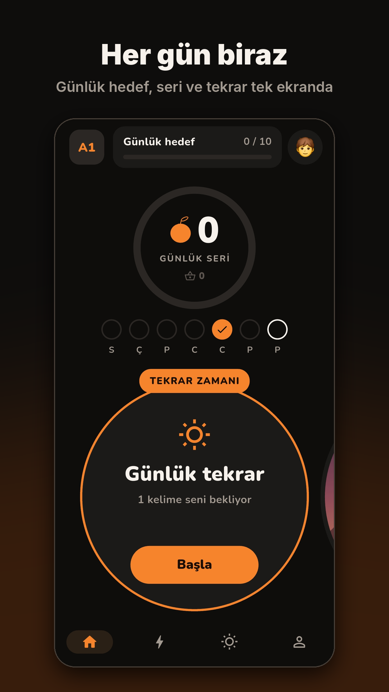
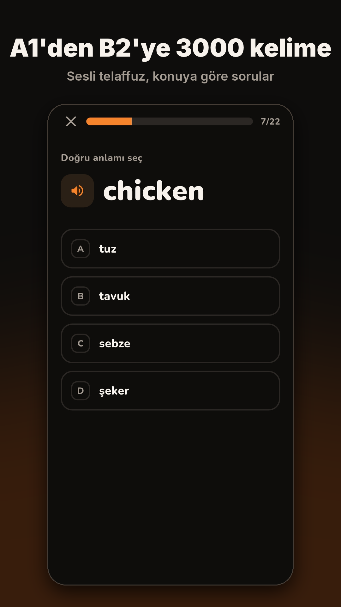
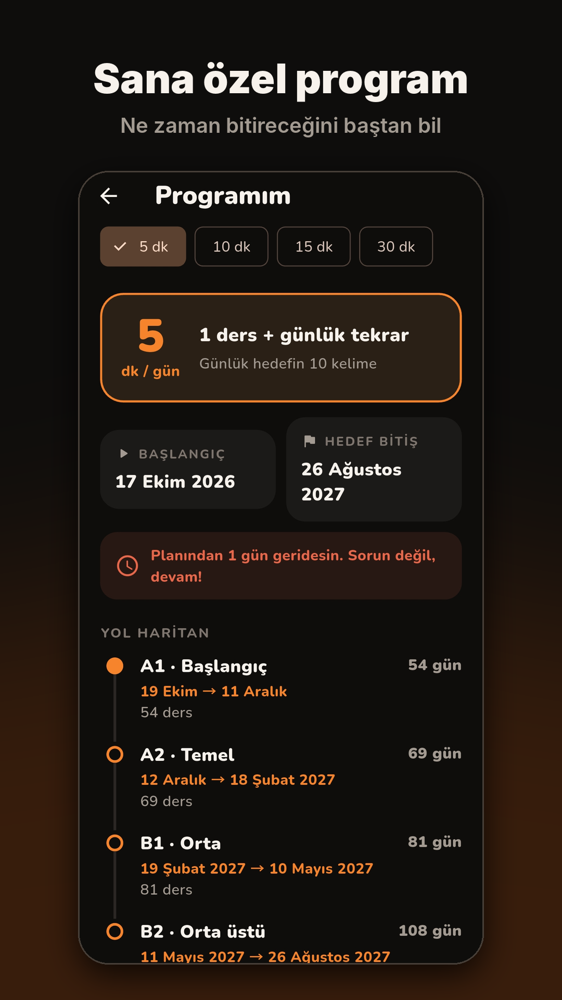

# ApriEnglish 🍑

**An Android app for Turkish speakers to learn 3,000 essential English words, from A1 to B2.**

ApriEnglish builds a short daily study plan for each learner, teaches words in small lessons, and brings back the words you get wrong more often until they stick. Every word comes with a natural, professionally recorded American English pronunciation.

> Status: in closed testing on Google Play.

<p align="center">
  
  
  
</p>

## Features

- **3,000 words in four levels** (A1, A2, B1, B2), each with its Turkish meaning
- **Personal daily plan:** a short onboarding asks for your level and daily time, then builds a study program for you
- **Short lessons** that introduce new words, then quiz you with multiple-choice and listening questions
- **Smart review:** words you answer wrong come back more often
- **Two quiz directions:** English → Turkish and Turkish → English
- **Native-quality pronunciation:** all 3,000 words were pre-recorded with Google Cloud Text-to-Speech (Chirp 3 HD voice), with the phone's text-to-speech as a fallback
- **Daily reminders** with local notifications
- **Works offline:** progress is stored on the device; no account needed

## Built with

- [Flutter](https://flutter.dev) & Dart
- `shared_preferences` for local storage
- `audioplayers` and `flutter_tts` for pronunciation
- `flutter_local_notifications` and `timezone` for reminders
- Python + Google Cloud Text-to-Speech + ffmpeg for generating the audio files (`araclar/seslendir.py`)

## Project structure

```
lib/
  ekranlar/     screens (home, lesson, onboarding, about...)
  bilesenler/   reusable widgets and drawings
  modeller/     data models (word, lesson, profile)
  servisler/    services (pronunciation, notifications, study plan, sound effects)
  paket.dart    the 3,000-word list
assets/
  telaffuz/     pronunciation recordings + dizin.json (word -> file)
araclar/
  seslendir.py  script that generates the recordings
```

Folder and variable names are in Turkish, since the app is made for Turkish learners.

## Running locally

```bash
flutter pub get
flutter run
```

Release builds need a signing key (`android/key.properties`), which is not included in this repository.

## About

I'm Abdülhamid Genç, a second-year Management Information Systems student. ApriEnglish started as a small Python command-line project ([vocabulary-trainer](https://github.com/Hamidgnc/vocabulary-trainer)) and grew into my first mobile app while I was learning Flutter.

Privacy policy: https://sites.google.com/view/aprienglish-gizlilik
